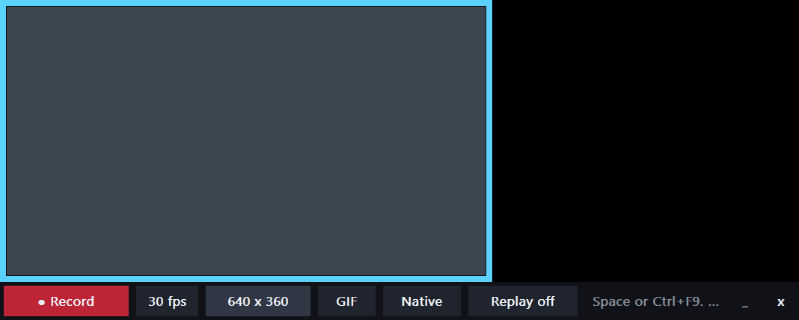

# TrontSnap devlog

Newest first. What changed, why, and how it was checked. Release notes live in
CHANGELOG.md; this is the working story behind them.

## 2026-10-31: TrontSnap Cam, instant replay, multi-select fix

**Where the asks came from.** The spicy-dev channel on the nativepixels Discord.
André asked for a minimal recorder: fullscreen or a window or a custom size, native
or chosen resolution and fps, MP4 / WEBM / GIF, keyboard shortcuts, keeps recording
while minimized, small, uses ffmpeg. "Just a small simple tool like GifCam."
aFoolsDuty added two more: an always-on buffer where one key saves the last 30 s,
and careful crop and zoom. Trent's own note: TrontSnap was supposed to be this, but
it isn't minimal. Credit to both of them for the push.

**Design calls.**
- The cam is its own process (`trontsnap cam`) and its own plain Win32 window, not
  another egui tab. It starts instantly and has nothing to do with the gallery.
- The frame's window region is ring + toolbar only. The middle isn't transparent,
  it isn't there, so the game underneath still gets clicks, hover and the wheel.
  Same lesson as the v0.7.3 REC HUD (color-key windows still hit-test on Win11).
- Everything is `WDA_EXCLUDEFROMCAPTURE`, so the toolbar can sit inside the frame
  for full-screen takes and still never shows up in the video.
- Capture stays on the existing path: DXGI duplication into Media Foundation
  H.264, with hardware encoding and audio. ffmpeg only runs after Stop, for GIF,
  WEBM and resizing. Piping live frames into ffmpeg was ruled out because VP9
  can't keep up at 1080p60, and GIF palette generation buffers the whole clip
  anyway. Without ffmpeg nothing breaks: MP4 records and GIF falls back to the
  built-in encoder.
- GIF uses one palette per clip, built from changed pixels (`stats_mode=diff`),
  and only changed rectangles are re-dithered. That gives small files for UI and
  game footage without shimmer. GIF fps is capped at 50, because browsers slow any
  faster frame delay down to 10 fps.
- The replay buffer is 5 s MP4 segments in %TEMP%, not frames in RAM. 30 s of raw
  1080p is about 7 GB; 30 s of H.264 is a few MB. On save, the segments are joined
  with a stream copy and cut to the tail. The first try cut 6.0 s instead of 8 s:
  the segment durations came from wall-clock time, which includes duplication
  setup. Measuring them from the encoded frame count gave exactly 8.000 s.
- Pixel art: 2x / 3x / 4x output uses nearest-neighbor, so pixels stay square.

**The multi-select bug.** Found by driving the real gallery grid in a headless egui
test with synthetic clicks. Ctrl+clicking two different shots quickly opened the
second one in Photos. egui counts any two clicks within 0.3 s as a double-click,
even on different widgets, and the gallery checked `double_clicked()` before
looking at modifiers. Now the gallery tracks which cell the last plain click hit
and only opens on a second click on the same cell. Modifier clicks never open.
While in there: plain click selects one, Shift replaces with a range, Ctrl+Shift
adds a range, and dragging or copying a selection takes all of it.

(Process note: the first run of that test reproduced the bug for real and opened
a Photos window with a blank fixture image. Tests now record OS side effects
instead of performing them.)

**Checked.**
- 64 tests pass.
- `trontsnap rec` recorded MP4 native at 30 fps, MP4 at 50% and 60 fps, GIF at
  15 fps, WEBM at 24 fps and GIF at 3x pixel. ffprobe matched codec, size and fps
  on every file, and each one decoded fully.
- `trontsnap replay-test 14 8` saved an 8.000 s clip.
- Not yet checked by hand: the cam window itself on the real desktop. That waits
  until Trent is off Demigod work.
